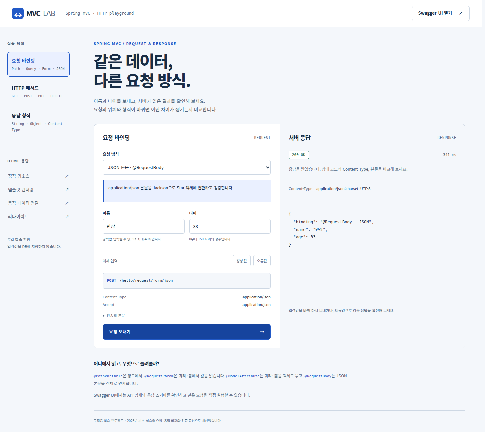
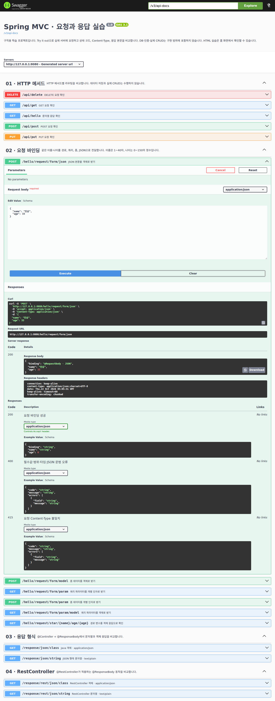
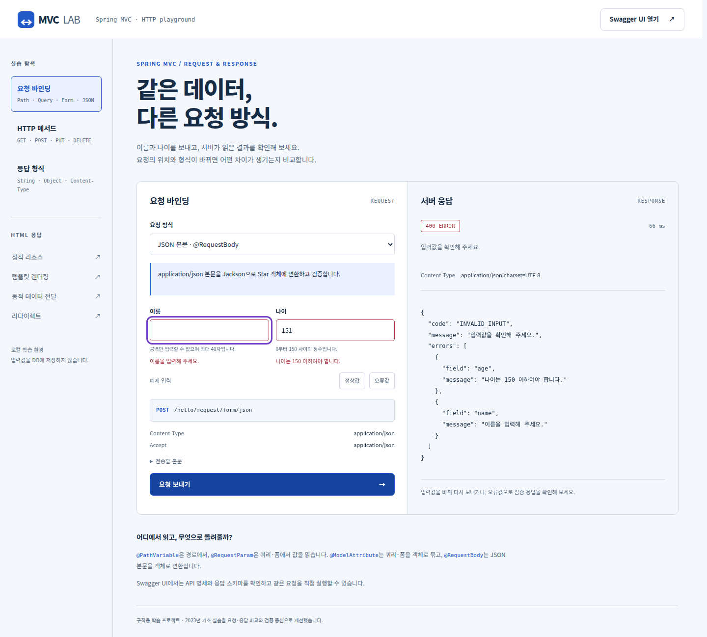
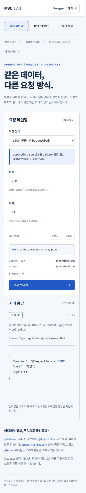

# Spring MVC · 요청과 응답 실습

**프론트엔드에서 보낸 데이터가 서버에서 어떻게 읽히고, 어떤 응답으로 돌아오는지 직접 비교하는 학습 프로젝트입니다.**

이 저장소는 **구직용 포트폴리오에 첨부하기 위해 정리한 학습 프로젝트**입니다. 2023년에 작성한 Spring MVC 기초 예제를 바탕으로, 웹 실습 화면·Swagger UI·입력 검증·자동화 테스트를 보완했습니다.

> 확인할 핵심: 요청 바인딩 6가지 · HTTP 메서드 4가지 · 응답 형식 비교 · HTML 렌더링 · 정상·오류 응답 검증

[실습 가이드](docs/PRACTICE.md) · [개선 기록](docs/IMPROVEMENTS.md) · [배포 가이드](docs/DEPLOYMENT.md) · [화면 설계 기준](DESIGN.md)

## 실행 화면

이름과 나이를 입력하면 요청 URL·헤더·본문과 **실제 서버의 상태 코드·Content-Type·응답 본문**을 같은 화면에서 확인할 수 있습니다.



<details>
<summary>Swagger UI · 오류 응답 · 모바일 화면 보기</summary>

Swagger UI에서 JSON 본문을 입력하고 실제 요청을 실행한 화면입니다.



검증 오류는 응답 본문과 입력칸에 함께 표시합니다.



모바일에서는 요청·응답 패널을 세로로 배치합니다.



</details>

## 실행 방법

**JDK 17**이 필요합니다. DB 설치와 API 키는 필요하지 않으며, 처음 실행할 때 의존성을 다운로드합니다.

```bash
./gradlew bootRun
```

Windows PowerShell에서는 다음 명령을 사용합니다.

```powershell
.\gradlew.bat bootRun
```

| 화면 | 실행 후 접속 주소 |
|---|---|
| 웹 실습 | http://localhost:8080/ |
| Swagger UI | http://localhost:8080/swagger-ui.html |
| OpenAPI JSON | http://localhost:8080/v3/api-docs |

웹 실습에서 요청 방식을 선택한 뒤 **요청 보내기**를 누릅니다. **오류값**을 넣어 400 응답을 확인하거나 Swagger UI의 **Try it out → Execute**로 같은 API를 실행할 수 있습니다.

## 무엇을 구현했는가

| 영역 | 구현 내용 | 확인할 역량 |
|---|---|---|
| 요청 바인딩 | 경로 변수, 쿼리·폼 인자, 쿼리·폼 객체, JSON 객체 | 요청 위치와 Content-Type에 맞는 데이터 전달 |
| 응답 비교 | 문자열·객체, Controller·RestController, 정적·동적 HTML | 응답 본문과 미디어 타입의 구분 |
| 검증·오류 처리 | 이름·나이 제약, 공통 오류 형식, 400·404·405·415 응답 | 클라이언트가 해석할 수 있는 API 오류 설계 |
| 웹 실습 도구 | 요청 미리보기, 실제 응답, 오류 안내, 중복 전송 방지 | 프론트엔드와 서버의 연결 및 상태 처리 |
| API 문서 | 실행 가능한 Swagger UI와 요청·응답 스키마 | 인터페이스 명세와 구현의 일치 |
| 테스트·자동화 | JUnit·MockMvc, 브라우저 시나리오, GitHub Actions | 동작을 재현하고 변경 후에도 검증하는 과정 |

이 프로젝트는 **서버 기본기를 확인하는 보조 포트폴리오**로 구성했습니다. DB·회원·인증·실제 리소스 CRUD는 구현 범위에 포함하지 않습니다. POST·PUT·DELETE 예제는 메서드별 라우팅을 비교하며 데이터를 저장하거나 변경하지 않습니다.

## 기존 예제에서 개선한 부분

- **출력 → 검증:** 결과를 콘솔에 출력하던 테스트를 값·상태 코드·응답 형식을 검증하는 테스트로 바꿨습니다.
- **문자열 삽입 → 데이터 표시:** 서버 응답을 `innerHTML`에 넣던 부분을 `textContent`로 변경해 입력값이 HTML로 실행되지 않게 했습니다.
- **기본 오류 → 설명 가능한 오류:** 잘못된 입력에 `code`, `message`, `errors`를 반환하고 화면의 입력칸에 연결했습니다.
- **코드만 존재 → 실행하며 비교:** Swagger UI와 웹 실습 도구, 실행 화면을 추가했습니다.
- **공유 변수 증가 → 동시성 처리:** 방문 횟수를 `AtomicLong`으로 증가시켰습니다. 값의 초기화·공유 범위도 설명했습니다.

구체적인 변경 이유와 검증 근거는 [개선 기록](docs/IMPROVEMENTS.md)에 정리했습니다.

## 기술 구성

| 구분 | 기술 |
|---|---|
| 서버 | Java 17, Spring Boot 3.5.16, Spring MVC |
| 화면 | Thymeleaf, HTML, CSS, JavaScript |
| 데이터·검증 | Jackson, Jakarta Bean Validation |
| API 문서 | springdoc-openapi 2.8.17, Swagger UI |
| 빌드·테스트 | Gradle 8.14.3, JUnit 5, MockMvc, Playwright |
| 자동화 | GitHub Actions |

기존 Spring Boot 3 기반 학습 흐름을 이어갈 수 있도록 같은 메이저 버전 안에서 정비했습니다. Node.js는 화면 검증 도구를 실행할 때만 사용합니다.

## 검증 방법

```bash
./gradlew clean build
```

서버 테스트 **40개**로 요청 바인딩, 입력 제약과 경계값, JSON 타입, 응답 형식, HTML·리다이렉트, OpenAPI 명세, 방문 횟수 동시성을 검증합니다.

웹 화면까지 확인하려면 서버를 실행한 상태에서 별도 터미널에서 실행합니다. Node.js 22 이상을 권장합니다.

```bash
npm ci
npm run check:ui
npx playwright install chromium
npm run test:browser
```

브라우저 검증에는 요청 바인딩 6종, 메서드 4종, 응답 4종, 오류·연결 실패 복구, 모바일·키보드, Swagger UI의 JSON·폼 요청 실행을 포함합니다. 캡처는 `build/browser-screenshots/`에 생성합니다.

GitHub Actions는 `main` 변경과 PR에서 빌드·서버 테스트·UI 검사·브라우저 검증을 실행하도록 구성했습니다.

## 코드 살펴보기

- [RequestController](src/main/java/com/sparta/springmvc/request/RequestController.java): 요청 방식에 따른 바인딩 비교
- [ApiExceptionHandler](src/main/java/com/sparta/springmvc/error/ApiExceptionHandler.java): 오류 응답 형식 통일
- [웹 실습 동작](src/main/resources/static/js/lab.js): 실제 요청 전송과 안전한 응답 출력
- [서버 통합 테스트](src/test/java/com/sparta/springmvc/MvcLabIntegrationTest.java): 요청·응답 계약 검증
- [브라우저 검증](scripts/browser-smoke.mjs): 화면에서 서버까지 이어지는 동작 확인

세부 실습은 [실습 가이드](docs/PRACTICE.md), 원본과 개선 범위는 [개선 기록](docs/IMPROVEMENTS.md)에서 확인할 수 있습니다.
