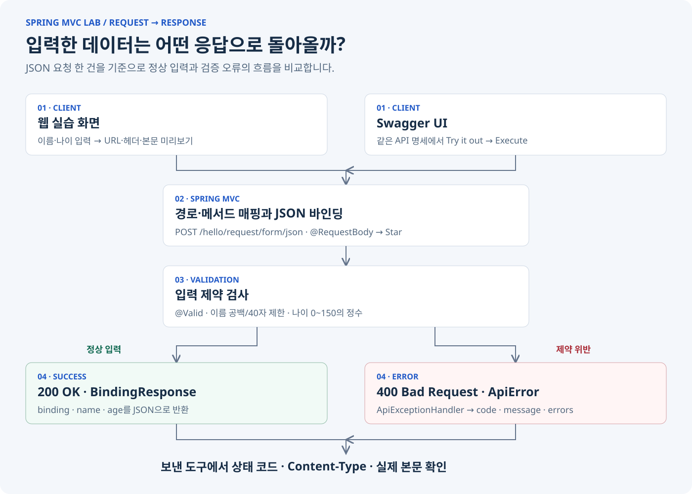

# 구조와 설계 지도

현재 코드가 해결하는 문제, 주요 설계 결정, 폴더 구조와 요청 처리 흐름을 한 문서에서 연결합니다. 검증 명령과 읽을 순서는 [프로젝트 문서 안내](../README.md)에서 확인할 수 있습니다.

## 1. 구현 목적과 설계 선택

| 문제 | 현재 선택 | 확인 지점 |
|---|---|---|
| 요청 위치와 바인딩 방식의 차이를 코드만으로 비교하기 어려움 | 경로·쿼리·폼·JSON 6가지 요청을 같은 이름·나이 응답으로 비교 | `RequestController`, 웹 실습 요청 미리보기 |
| 바인딩 실패와 입력 제약 위반을 구분하기 어려움 | 공통 `ApiError`와 `INVALID_REQUEST`·`INVALID_INPUT` 분류 | `ApiExceptionHandler`, `ErrorResponseContractTest` |
| 문자열·객체 응답의 선언 차이가 화면에 드러나지 않음 | 실제 Content-Type과 응답 본문을 같은 패널에서 비교 | `ResponseController`, `ResponseRestController` |
| 서버 오류가 입력 상태와 연결되지 않음 | `errors[].field`를 기준으로 문구·`aria-invalid`·오류 필드 포커스 적용 | `lab.js`, `index.html`, 브라우저 테스트 |
| 응답 문자열을 HTML로 해석할 위험 | 결과를 `textContent`로 출력하고 UI 정적 검사에서 `innerHTML` 미사용 확인 | `lab.js`, `project/tools/check-ui.mjs` |
| 서버·화면·배포 계약의 검증이 분리됨 | Gradle·UI 정적 검사·Playwright·Docker를 CI 한 흐름으로 연결 | `.github/workflows/ci.yml` |

| 결정 | 선택 이유 | 범위와 비용 |
|---|---|---|
| 요청·응답 DTO를 `request.Star`와 `response.Star`로 분리 | 입력 제약과 응답 직렬화 예제의 책임 구분 | 유사 필드는 패키지 경로로 구분해야 함 |
| `ResponseEntityExceptionHandler`를 확장해 `ApiError`로 변환 | Spring 상태 분류를 활용하면서 일관된 오류 형식 제공 | Spring Boot 변경 시 상위 처리 규칙과 계약 테스트를 함께 확인 |
| Jackson의 숫자 문자열·소수 변환과 알 수 없는 속성을 거부 | 폼 문자열 변환과 JSON 타입 검사의 차이를 명확히 학습 | 실제 서비스라면 기존 클라이언트 호환성 판단 필요 |
| 방문 횟수를 인스턴스 `AtomicLong`으로 관리 | 저장소 없이 모델 전달과 공유 값 동시성에 집중 | 재시작 시 초기화되고 인스턴스 사이에 공유되지 않음 |
| 실행 코드를 기술별 폴더로 나누고 루트 Gradle 프로젝트 유지 | 서버·화면 코드를 바로 찾으면서 실행·배포 명령 유지 | `settings.gradle`과 source set 연결 규칙 관리 필요 |

DB·인증·영속 CRUD와 운영 트래픽 성능 측정은 구현 범위에 포함하지 않습니다.

## 2. 폴더 구조

저장소 루트에는 프로젝트 소개와 빌드·배포 진입점을 둡니다. Java 서버 코드는 `backend-java`, Thymeleaf 화면은 `frontend-thymeleaf`, 문서·테스트·검증 도구는 `project`에서 관리합니다.

### 서버 코드 · `backend-java/src/main/java/com/sparta/springmvc/`

| 패키지·파일 | 역할 |
|---|---|
| `SpringMvcApplication.java` | 애플리케이션 시작 |
| `config/` | OpenAPI 설명과 Swagger 설정 |
| `security/` | Jackson 입력 제약과 공통 응답 보안 헤더 |
| `controller/` | GET·POST·PUT·DELETE 라우팅 예제 |
| `request/` | 경로·쿼리·폼·JSON 요청 바인딩과 DTO |
| `response/` | Controller·RestController의 문자열·객체 응답 비교 |
| `html/` | 정적 HTML·템플릿·모델·리다이렉트 예제 |
| `error/` | 공통 오류 응답과 예외 처리. 단계별 분류는 4절 |

### 화면 · `frontend-thymeleaf/src/main/resources/`

| 경로 | 역할 |
|---|---|
| `templates/index.html` | 요청·응답 실습 홈 |
| `templates/java-swagger.html` | `/java-swagger` 주소를 유지하는 Swagger UI 셸 |
| `templates/hello.html` · `hello-visit.html` | Thymeleaf 렌더링 예제 |
| `static/js/lab.js` | 요청 미리보기·전송·응답 표시·오류 복구 |
| `static/js/java-swagger.js` | 같은 출처 `/v3/api-docs`를 사용하는 Swagger UI 초기화 |
| `static/css/lab.css` | 공통 스타일·반응형·접근성 상태 |
| `static/hello.html` | 정적 HTML 응답 예제 |

### 서버 설정 · `backend-java/src/main/resources/`

| 경로 | 역할 |
|---|---|
| `application.properties` | 로컬 기본 설정. Jackson 엄격 변환 옵션 포함 |
| `application-render.properties` | Render 포트와 프록시 설정 |

### 검증 도구와 루트 파일

| 위치 | 역할 |
|---|---|
| `project/tests/backend-java/java/com/sparta/springmvc/` | JUnit·MockMvc 서버 계약 테스트 |
| `project/tests/frontend-thymeleaf/browser-smoke.mjs` | 실제 화면과 Swagger API의 브라우저 흐름 검증 |
| `project/tools/check-ui.mjs` | 디자인 토큰·레이블·상태 안내·안전한 출력 검사. [UI 가이드](../design/guide.md)의 frontmatter와 `lab.css` 토큰 일치 확인 |
| `project/tools/premium-ui.json` | UI 검증 대상·기능·명령 설정 |
| `project/package.json` · `project/package-lock.json` | UI 정적·브라우저 검증 명령과 의존성 버전 |
| `.github/workflows/ci.yml` | 빌드부터 512 MB Docker 실행까지 자동 검증 |
| `backend-java/build.gradle` | Java·테스트 의존성과 백엔드·프런트엔드 `sourceSets` 정의 |
| `settings.gradle` · `gradlew` · `gradle/wrapper/` | 루트 빌드 진입점. `settings.gradle`이 백엔드 빌드 파일을 연결 |
| `Dockerfile` · `render.yaml` | 컨테이너 빌드와 Render 배포 설정 |
| `.gitignore` · `.gitattributes` · `.dockerignore` | Git·Docker 기본 동작 |

`settings.gradle`은 `rootProject.buildFileName`을 `backend-java/build.gradle`로 지정합니다. 따라서 `./gradlew bootRun`·`./gradlew clean build`와 루트 `build/` 산출물 경로를 유지하면서, Gradle이 `backend-java/src/main`과 `frontend-thymeleaf/src/main/resources`를 하나의 JAR에 포함하고 `project/tests/backend-java/java`를 테스트 source set으로 실행합니다. Node.js는 화면 검증에만 사용합니다. 검증 캡처와 로그는 루트 `build/`에 생성하며 버전 관리에서 제외합니다.

화면은 Spring이 제공하는 Thymeleaf 템플릿과 정적 자산으로 구성합니다. 퍼블리싱·접근성 계약과 자동 검증 범위는 [UI·접근성 가이드](../design/guide.md)에서 관리합니다.

## 3. 핵심 데이터

DB 엔티티는 사용하지 않습니다. 아래 타입은 요청과 응답을 표현하는 DTO입니다.

| 타입 | 위치 | 필드 | 역할 |
|---|---|---|---|
| `Star` (request) | `request/Star.java` | `name: String` (`@NotBlank`, `@Size(max=40)`) · `age: Integer` (`@NotNull`, `@Min(0)`, `@Max(150)`) | 입력 DTO. 제약과 오류 문구의 원본 |
| `BindingResponse` | `request/BindingResponse.java` | `binding` · `name` · `age` | 바인딩 성공 응답. `binding`은 값을 읽은 애노테이션 이름 |
| `ApiError` | `error/ApiError.java` | `code` · `message` · `errors: List<FieldError>` | 예외 처리기가 반환하는 공통 오류 형식 |
| `ApiError.FieldError` | 〃 | `field` · `message` | 오류를 표시할 입력 필드와 안내 문구. `field`는 `name` 또는 `age` |
| `Star` (response) | `response/Star.java` | `name: String` · `age: int` | JSON 직렬화 비교용. 입력 제약이 있는 요청 DTO와 분리 |
| `MethodResponse` | `controller/HelloController.java` | `method` · `message` | HTTP 메서드 라우팅 확인용 |

요청 DTO의 `age`는 `Integer`로 선언해 누락(`null`)과 0을 구분하고, `@NotNull`로 누락을 검증합니다. 응답 비교용 DTO에는 `int`를 사용합니다. 두 `Star`는 DB 엔티티가 아닌 요청·응답 DTO입니다.

## 4. 요청 한 건이 응답이 되기까지

`POST /hello/request/form/json`을 기준으로 요청 처리 흐름을 설명하고, 다른 바인딩 방식과의 차이도 함께 정리했습니다. 1~6은 정상 응답의 처리 흐름입니다. 처리 중 예외가 발생하면 정상 흐름을 중단하고 7단계의 공통 오류 처리로 이동합니다.

| # | 단계 | 담당 | 실패 시 예외 | 응답 `code` |
|---|---|---|---|---|
| 1 | 라우팅: 경로·메서드 매칭 | `DispatcherServlet` → `@RequestMapping` | `NoResourceFoundException` / `HttpRequestMethodNotSupportedException` | 404 `NOT_FOUND` / 405 `METHOD_NOT_ALLOWED` |
| 2 | 미디어 타입: `consumes`·`produces` | 〃 | `HttpMediaTypeNotSupportedException` / `HttpMediaTypeNotAcceptableException` | 415 `UNSUPPORTED_MEDIA_TYPE` / 406 `NOT_ACCEPTABLE` |
| 3 | 객체 만들기(바인딩) | `@RequestBody`는 Jackson, `@ModelAttribute`는 `DataBinder`, `@RequestParam`·`@PathVariable`은 `ConversionService` | JSON: `HttpMessageNotReadableException` · 개별 인자: `MissingServletRequestParameterException`, `MethodArgumentTypeMismatchException` · `@ModelAttribute`: 오류가 `BindingResult`에 쌓여 4단계로 넘어감 | 400 `INVALID_REQUEST` |
| 4 | 검증 | 객체 인자는 `@Valid` → Bean Validation, 개별 인자는 클래스 `@Validated` → 메서드 검증 | `MethodArgumentNotValidException` / `ConstraintViolationException` | 400 `INVALID_INPUT` + `errors[]` |
| 5 | 핸들러 실행 | `RequestController.json()` | 분류되지 않은 예외 | 500 `INTERNAL_ERROR` |
| 6 | 직렬화 | `@ResponseBody` → Jackson | — | 200 `BindingResponse` |
| 7 | 예외 → `ApiError` | `ApiExceptionHandler` | — | 위 `code` |

JSON 문법·타입 오류는 `INVALID_REQUEST`와 빈 `errors[]`로 응답합니다. 개별 파라미터의 누락·타입 변환 오류도 `INVALID_REQUEST`이지만, 해당 필드 정보가 포함됩니다. 입력 제약 위반은 `INVALID_INPUT`과 필드별 오류로 응답합니다.

`@ModelAttribute`는 타입 변환 실패도 `BindingResult`에 담아 검증 오류와 함께 처리합니다. 따라서 같은 `age=abc`도 `@RequestParam`에서는 `INVALID_REQUEST`, `@ModelAttribute`에서는 `INVALID_INPUT`입니다. 이 차이는 `ErrorResponseContractTest.sameWrongAgeIsClassifiedByBindingStyle`에서 검증합니다.

화면(`lab.js`)에는 상태 코드와 Content-Type, 응답 본문을 표시합니다. 본문은 성공 여부와 관계없이 `textContent`로 출력합니다. 오류 응답의 `errors[]`에 `field`가 `name`·`age`인 항목이 있으면 해당 입력칸에 `aria-invalid`와 오류 문구를 적용합니다.

## 5. 변경 영향 범위

| 바꾸려는 것 | 함께 확인할 곳 |
|---|---|
| 나이 범위(0~150)·이름 길이(40) | `request/Star.java` 애노테이션·메시지 · `RequestController`의 `@Min`·`@Max`·`@Size`(개별 인자용, 두 곳이 같아야 함) · `ApiExceptionHandler.constraints()` 문구 · `@Tag` 설명 · [실습 가이드 2절](practice.md#2-검증오류-응답) · `MvcLabIntegrationTest` 경계값·`longName` · `browser-smoke.mjs` 오류 시나리오 |
| `ApiError` 필드 추가·이름 변경 | `lab.js`의 `message`·`errors`·`field` 접근 · `MvcLabIntegrationTest`·`ErrorResponseContractTest`의 jsonPath · [실습 가이드 2절](practice.md#2-검증오류-응답) 예시 (OpenAPI 스키마는 자동 반영) |
| 오류 `code` 값 | `ApiExceptionHandler`의 두 switch · 4절 표 · [실습 가이드 2절](practice.md#2-검증오류-응답) · 테스트의 `$.code` |
| `BindingResponse` 필드 이름 | `lab.js` 표시 · 테스트 `assertBinding` · [실습 가이드 1절](practice.md#1-요청-바인딩-비교) 예시 |
| 실습 URL(`/hello/request/**` 등) | `lab.js` URL 조립 · `springdoc.paths-to-match` · `browser-smoke.mjs` · `ci.yml`의 curl · 문서 표 |
| Jackson 변환 설정 | `application.properties` · `invalidJsonFormat`·`jsonTypeMismatchFailsBeforeObjectExists` 테스트 · [실습 가이드 JSON 절](practice.md#json-요청) |
| 색상·간격 토큰 | `lab.css`의 `:root` · [UI 가이드](../design/guide.md) frontmatter · `check-ui.mjs`가 둘의 일치를 검사 |
| Spring Boot 버전 | `backend-java/build.gradle` · 부모 `ResponseEntityExceptionHandler`가 다루는 예외 목록이 바뀔 수 있으므로 `wrongContentTypeAndMethod`·`ErrorResponseContractTest` 결과를 먼저 확인 |

요청 DTO나 바인딩 규칙을 바꾸면 주로 `request/`를 확인해야 합니다. 공통 예외 처리(`error/`)나 Jackson 설정을 바꾸면 `controller/`·`response/`·`html/`의 응답도 함께 확인합니다.

[프로젝트 소개](../../../README.md) · [문서 안내](../README.md) · [실습 예제](practice.md) · [보안 설계](security.md)
